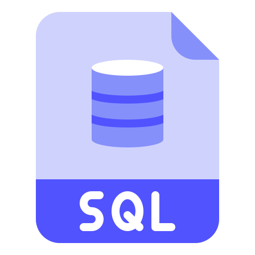
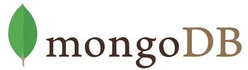

<p align="center">
  <a href="http://nestjs.com/" target="blank"></a>
</p>

|   | MyApi SQL Template |
| - | ------------ |
| ⚡️ | **Launch your api instantly** watching changes with live-reload |
| 📈 | **Highly scalable** using [Repository design pattern](https://docs.nestjs.com/techniques/database#repository-pattern) to access the database even easier |
| 😎 | **OpenAPI** with [Swagger](https://docs.nestjs.com/openapi/introduction) to describe your RESTful APIs |
| ✨ | **KISS principle** make everything as simple as possible, but not simpler |
| 📱 | **Mobile friendly** supporting Cross-origin resource sharing (CORS) with a list of domains for restricted resources |
| 🔑 | **Security** using JWT authentication strategy with [Passport](https://docs.nestjs.com/techniques/authentication) and other techniques to increase the security of your applications |
| 👥 | **Made for Users.** Easily validate permissions for specific routes using [Guards](https://docs.nestjs.com/guards) with a Role-based access control
| ⏱ | Don't repeat yourself, Single responsibility principle. |
| 🔗 | **Validation:** provides pipes available right out-of-the-box with [class-validator](https://github.com/typestack/class-validator) to enforce validation rules for all incoming client payloads |
| ⚠️ | **Logger** with [Winston](https://github.com/winstonjs/winston) using different levels to track exceptions easily |
| 🔄 | **Migrations** using [TypeORM](https://github.com/typeorm/typeorm) to apply incremental updates to the database |

## Demo 🎮

Do you want to see this template in action? Visit https://myapi-template.herokuapp.com/api yay! 🎉
- API for MercadoPago Checkout: https://github.com/proyecto26/mercadopago-api

## Options (Database Type) 💻

<table>
  <tr>
    <td>
      <a href="https://github.com/proyecto26/MyAPI/tree/master">
        
      </a>
    </td>
    <td>
      <a href="https://github.com/proyecto26/MyAPI/tree/nosql">
        
      </a>
    </td>
  </tr>
</table>

## Installation 📚

```bash
# install dependencies
$ yarn
```

## Running the app ▶

```bash
# development
$ yarn start

# watch mode
$ yarn start:dev

# production mode
$ yarn start:prod
```

## Running migrations ▶

```bash
# run migration
$ yarn migration

# create migration
$ yarn migration:create

# revert migration
$ yarn migration:revert
```

## Test 🕵️

```bash
# unit tests
$ yarn test

# e2e tests
$ yarn test:e2e

# test coverage
$ yarn test:cov
```

## TypeORM 📖
* [Relations](https://github.com/typeorm/typeorm/blob/master/docs/relations.md)
* [Find Options](https://github.com/typeorm/typeorm/blob/master/docs/select-query-builder.md)
* [Query Builder](https://github.com/typeorm/typeorm/blob/master/docs/select-query-builder.md)

## Resources 📚

- [Implementing Microservices](https://frontegg.com/blog/implementing-microservices-in-nodejs)
- [A microservice that handles the queue of sending emails](https://pietrzakadrian.com/blog/how-to-create-a-microservice-that-handles-the-queue-of-sending-emails-in-nestjs)
- [Testing with NestJS like a Pro](https://dev.to/jdnichollsc/testing-with-nestjs-like-a-pro-3i2b)

## Credits 👍
* **typescript-starter:** [Nest framework TypeScript starter repository](https://github.com/nestjs/typescript-starter).

## Star History 🌟

[](https://star-history.com/#proyecto26/MyAPI-code&Date)

## Sponsors 💜

This project is free and open source. Sponsors help keep it maintained and growing.

[**Become a Sponsor**](https://github.com/sponsors/proyecto26) | [Sponsorship Program](https://proyecto26.com/sponsors/)

## Contribution 🤝

When contributing to this repository, please first discuss the change you wish to make via issue,
email, or any other method with the owners of this repository before making a change.
 
Contributions are what make the open-source community such an amazing place to learn, inspire, and create. Any contributions you make are **greatly appreciated** ❤️.
 
You can learn more about how you can contribute to this project in the [contribution guide](https://github.com/proyecto26/.github/blob/master/CONTRIBUTING.md).

## Happy coding 💯
Made with ❤️ by [Proyecto 26](https://proyecto26.com) - Changing the world with small contributions.

One hand can accomplish great things, but many can take you into space and beyond! 🌌

Together we do more, together we are more ❤️ 
